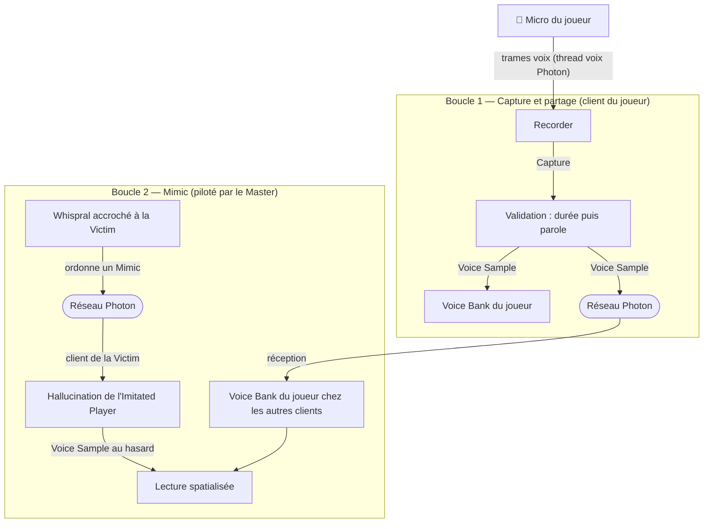
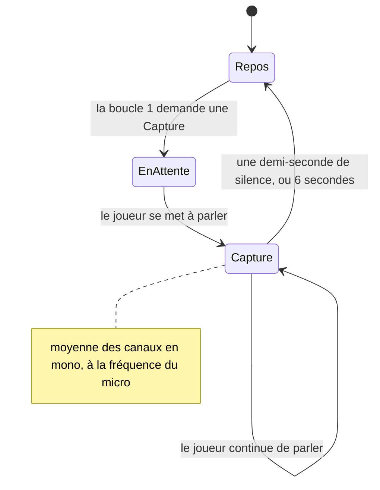
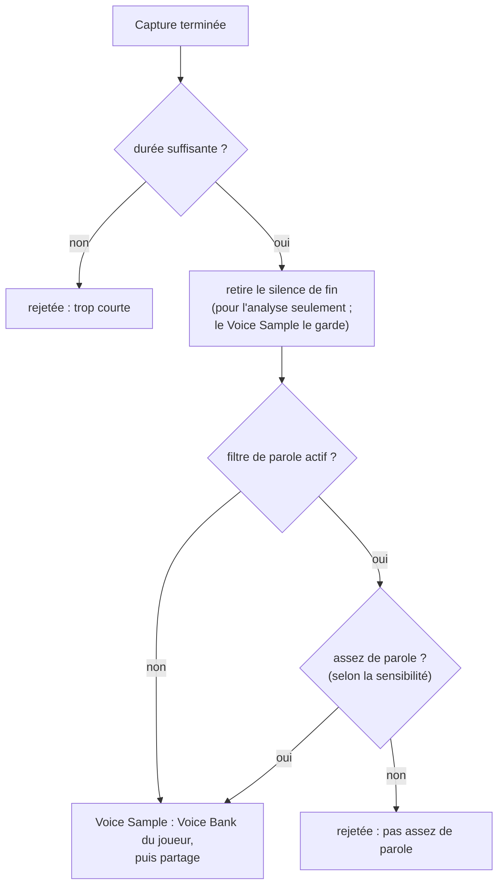
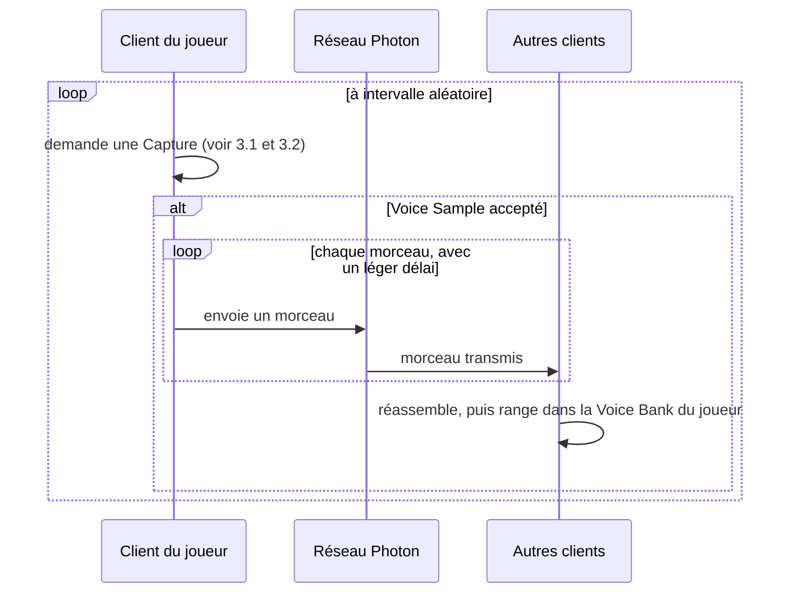
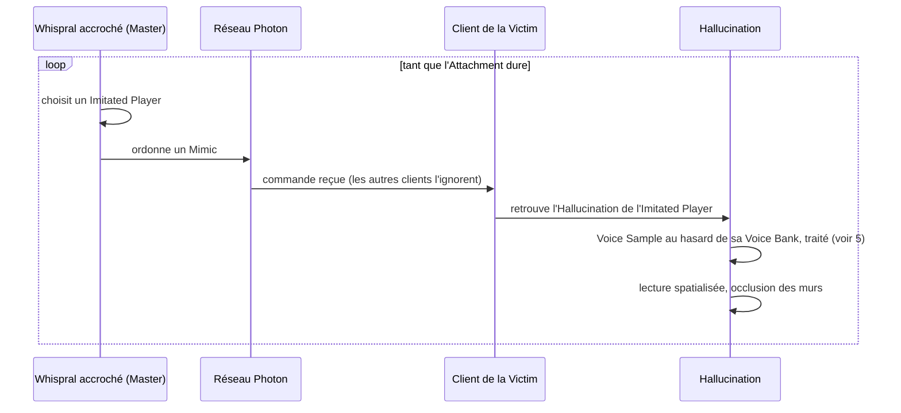
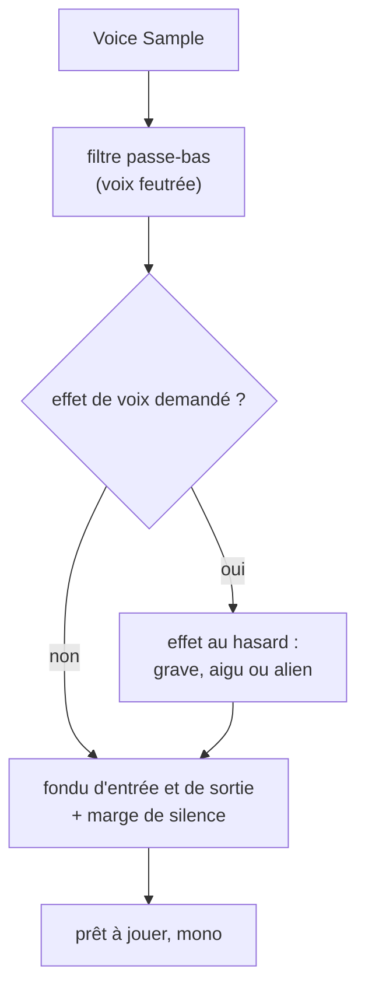

# Système de voix Whispral (Mimic) — Fonctionnement end-to-end

Le parcours d'une voix : du micro d'un joueur jusqu'au Mimic d'une Hallucination chez la Victim. Les termes sont ceux
de [`GLOSSARY.md`](../GLOSSARY.md). Le filtrage de parole (WebRTC VAD) est détaillé dans
[`vad-integration.md`](./vad-integration.md).

---

## 1. Vue d'ensemble

Deux boucles indépendantes :

- **Boucle 1 — Capture et partage** : chaque client capture la voix de son joueur, garde les Captures qui contiennent
  de la parole comme Voice Samples, les range dans la Voice Bank du joueur et les partage aux autres clients.
- **Boucle 2 — Mimic** : quand un Whispral est accroché à une Victim, le Master ordonne régulièrement au client de la
  Victim de faire parler une Hallucination avec un Voice Sample de son Imitated Player.

Le recorder, le filtre de parole et le store des Voice Banks existent une fois par client.

---

## 2. Le format audio vient des trames

Photon expose **deux formats** pour une voix : celui de l'**encodeur** (`Info.SamplingRate` / `Info.Channels`, ex.
48000 mono) et celui du **micro** (`InputSamplingRate` / `InputChannels`, ex. 44100 stéréo). Les trames poussées dans
`LocalVoiceFramed<short>.PushDataAsync` sont au format du **micro** : les étiqueter avec celui de l'encodeur déforme la
voix à la relecture (hauteur et vitesse). Selon la version de PhotonVoice, les propriétés `Input*` manquent ; la
fréquence se déduit alors de la durée d'une trame (`FrameDurationUs`).

La fréquence voyage ensuite avec le Voice Sample (en-tête WAV), et la lecture la réutilise : chaque client peut avoir un
micro différent (16 k / 44,1 k / 48 k) sans déformation.

---

## 3. Boucle 1 — Capture, validation, partage

### 3.1 Capture (thread voix Photon)

Le recorder ne fait qu'accumuler ; chaque Capture terminée passe au thread principal par une file thread-safe.

### 3.2 Validation (tâche de fond)

Le thread principal vide la file ; la validation, l'encodage et la sauvegarde tournent dans une tâche de fond, puis le
Voice Sample accepté repasse au thread principal pour le partage.

### 3.3 Partage réseau

Les morceaux passent par l'avatar du joueur (`VoiceSampleSharing`) et ne portent ni nom, ni Steam ID, ni fréquence :
le récepteur reconnaît l'expéditeur au propriétaire de l'avatar, et la fréquence est dans l'en-tête WAV. Un premier
morceau recommence le transfert ; un joueur qui part emporte son avatar, et le transfert en cours avec lui.

Une Voice Bank est rangée sous le Steam ID du joueur, le pseudo en repli sans Steam (ADR-0006), et plafonnée : le plus
ancien Voice Sample part en premier.

---

## 4. Boucle 2 — Mimic

---

## 5. Traitement à la lecture

Le Master tire l'effet de voix au hasard, seulement si `Voice Filter Enabled?` est activé dans sa config. L'occlusion des murs passe par
`AudioLowPassLogic`, comme les vraies voix du jeu.

Les entrées de config sont décrites dans [`WIKI.md`](../WIKI.md).
